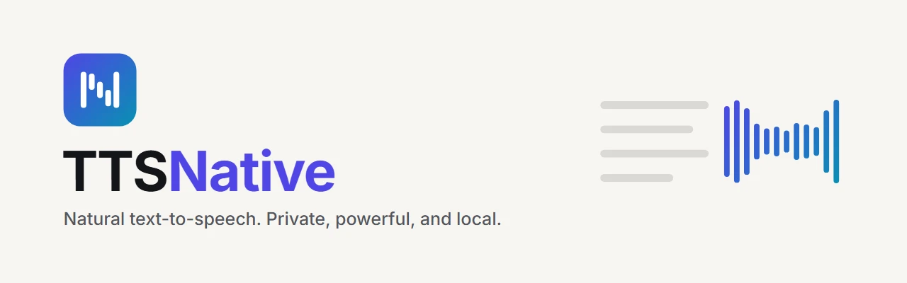
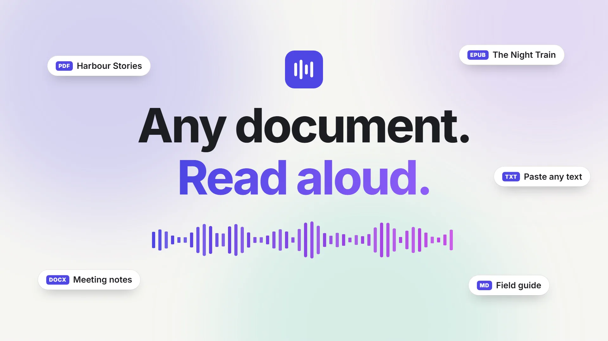
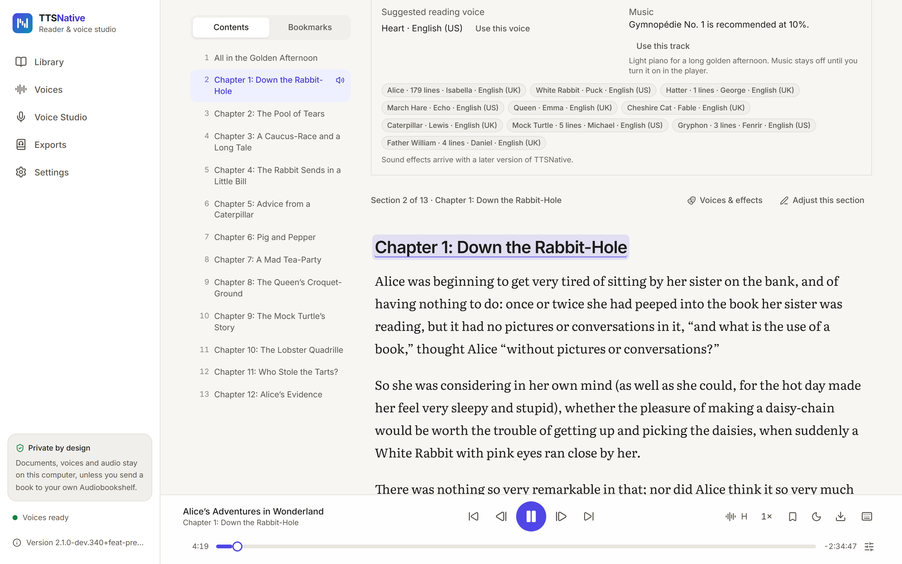
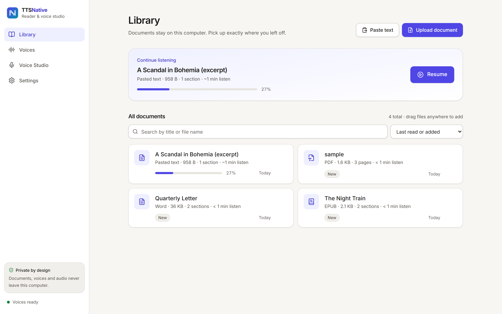
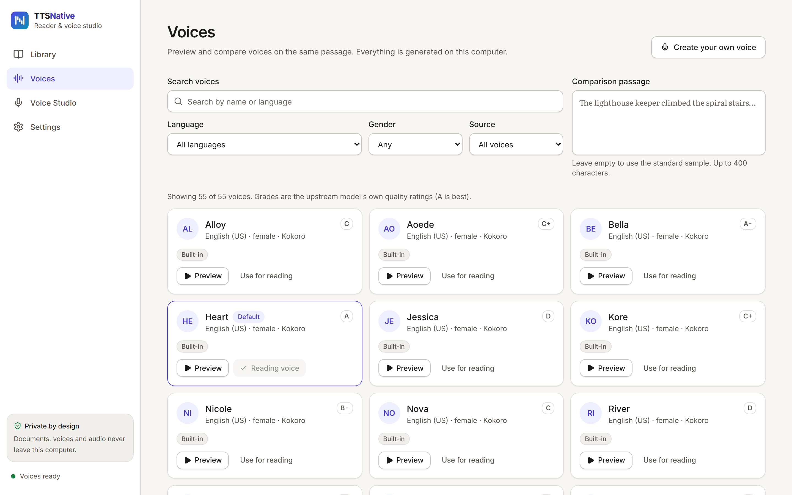
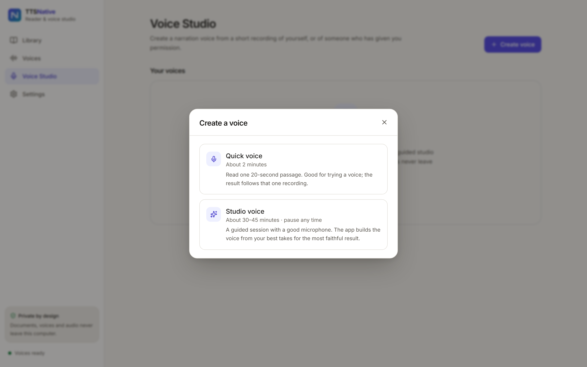
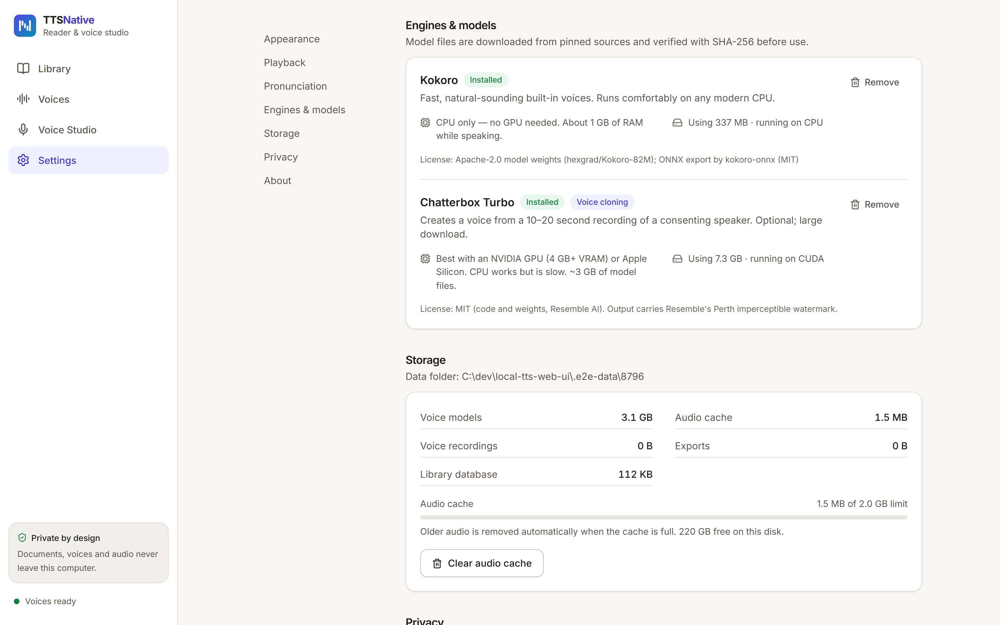
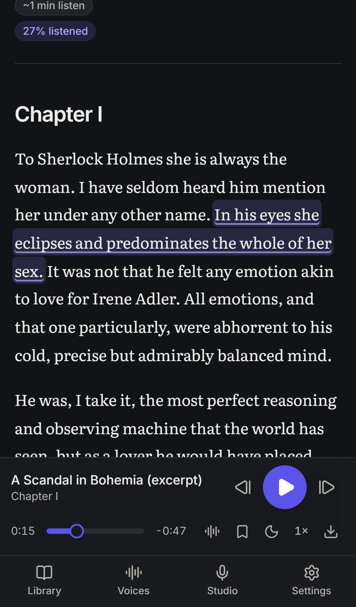

<p align="center">
  <picture>
    <source media="(prefers-color-scheme: dark)" srcset="brand/webp/ttsnative-banner-dark.webp" />
    
  </picture>
</p>

<p align="center">
  <a href="https://ttsnative.com/"><strong>Website</strong></a> ·
  <a href="#quick-start"><strong>Install</strong></a> ·
  <a href="https://github.com/carsonmcrae/ttsnative/wiki"><strong>User guide</strong></a> ·
  <a href="https://github.com/carsonmcrae/ttsnative/releases/latest"><strong>Latest release</strong></a>
</p>

<p align="center">
  <a href="https://github.com/carsonmcrae/ttsnative/actions/workflows/ci.yml"></a>
  <a href="https://github.com/carsonmcrae/ttsnative/actions/workflows/codeql.yml"></a>
  <a href="https://github.com/carsonmcrae/ttsnative/releases/latest"></a>
  <a href="LICENSE"></a>
</p>

# TTSNative

**Natural text-to-speech. Private, powerful, and local.**

TTSNative reads your documents aloud with natural voices, on your own computer. Open a PDF, Word document,
EPUB, Markdown or text file, press Play, and follow along as each sentence is highlighted. Speech is
generated locally: no accounts, no subscriptions, no telemetry and no cloud inference. Optionally, create
a narration voice from a recording of yourself, with your consent built in.

TTSNative is free and open source (MIT). It was called **Local TTS** until version 2.0.

<p align="center">
  <a href="https://ttsnative.com/#overview"></a>
  <br />
  <a href="https://ttsnative.com/#overview"><strong>▶ Watch the overview (0:45)</strong></a> (the voice-over is spoken by TTSNative)
  · <a href="https://ttsnative.com/#demo"><strong>▶ Watch the demo (2:23)</strong></a> (recorded from the running app, with its real narration)
</p>



## Features

- **Reader** — PDF, DOCX, EPUB, MOBI, FB2, HTML, Markdown, TXT, a web page by its address or pasted text
  (with optional speech marks such as `{pause 2s}`). Sentence-by-sentence read-along, chapter and page
  navigation, resume where you left off, keyboard shortcuts and lock-screen media controls.
- **Study and listening aids** — search inside a document, bookmarks with notes (exported as Markdown), a
  sleep timer, adjustable text size, spacing and typeface, a searchable and sortable library, and a fix for
  chapters that start in the wrong place.
- **Characters and effects** — select text to read it in another voice or accent, as a loudspeaker
  announcement, a phone call or a radio broadcast, give each character a voice (reusable cast presets), or
  choose one voice for all dialogue while the narration keeps yours; exports sound the same. Blend built-in
  voices into new ones.
- **Pronunciation dictionary** — teach every voice how to say character names and unusual words; only the
  sentences that contain a changed word are regenerated.
- **Starts instantly, even for whole books** — sentences are generated just ahead of you and cached, so
  playback begins in about a second and long documents never need to be rendered up front.
- **54 natural voices** (Kokoro-82M) across English (US/UK), Spanish, French, Hindi, Italian, Portuguese,
  Japanese and Mandarin, with quality grades and side-by-side comparison on your own passage.
- **Voice Studio (optional)** — create a voice from a 10–20 second recording or an existing clip, or record a
  guided studio session (lossless, resumable, a foundation passage and about 15 suggested passages with reading
  hints, an early version after about a minute) that the app builds into your most faithful voice, with its own
  speaking styles for questions, dialogue and lively lines, and switches back if a rebuild sounds worse. Takes you can play back, checks that explain what went wrong
  (completeness and background noise as advice), explicit consent, a delivery setting, sharing as a `.ttsvoice`
  file and one-click permanent deletion.
- **Export** — WAV, MP3, M4B audiobooks with chapters and a cover, or read-along EPUB 3; the whole document or
  selected chapters, one file or one per chapter, with optional sentence-timed subtitles (SRT). Long exports
  pause, resume and survive a restart, and can be sent to your Audiobookshelf server.
- **Private by design** — binds to `127.0.0.1`, works offline after setup, and never sends documents or
  recordings anywhere.
- **Phones and tablets (optional)** — pair a phone on the same Wi-Fi to read and listen from it; the computer
  does the reading.
- Light and dark themes, high contrast, wider letter spacing, responsive layout for phones and tablets,
  accessible controls (WCAG 2.2 AA target, axe-checked).

## Quick start

You need **Node.js 22.22 or newer** and Git. That's all — the first run installs everything else inside
this folder.

```bash
git clone https://github.com/carsonmcrae/ttsnative.git
cd ttsnative
npm install
npm run dev
```

The first `npm run dev` uses your own [uv](https://docs.astral.sh/uv/) if it is version 0.9 or newer, and
otherwise downloads a checksum-verified copy. uv installs Python 3.12 and the locked dependencies into `.tools/` and `apps/server/.venv`, then downloads the
Kokoro voice model (~340 MB, SHA-256 verified). Later starts take a few seconds. Your browser opens at
`http://127.0.0.1:5173`. Press **Ctrl+C** to stop.

Nothing is installed system-wide. To remove everything, delete the folder.

## Requirements

|         | Basic reader (Kokoro)     | Voice cloning (Chatterbox, optional)                                          |
| ------- | ------------------------- | ----------------------------------------------------------------------------- |
| Disk    | ~0.7 GB (runtime + model) | +8 GB with NVIDIA CUDA (measured); about +4.5 GB CPU-only (estimated)         |
| Memory  | ~1 GB while speaking      | 4 GB+ RAM; 4 GB+ VRAM with a GPU                                              |
| GPU     | Not needed                | Recommended (NVIDIA or Apple Silicon); CPU works but is slower than real time |
| Network | First run only            | One-time download from Settings                                               |

## Supported formats

| Format        | Notes                                                                                                                                                                                                                              |
| ------------- | ---------------------------------------------------------------------------------------------------------------------------------------------------------------------------------------------------------------------------------- |
| PDF           | Text PDFs; chapters from the outline or one section per page; running headers, footers and page numbers skipped when reading (still visible; undo). Scanned (image-only) PDFs are detected and reported — OCR isn't supported yet. |
| DOCX          | Headings become chapters; tables are read row by row. Macros and embedded objects are ignored.                                                                                                                                     |
| EPUB 2/3      | Chapters from the table of contents. Scripts and styles are ignored.                                                                                                                                                               |
| Markdown, TXT | Headings / "Chapter N" lines become sections; UTF-8, UTF-16 and Windows-1252 text.                                                                                                                                                 |
| MOBI          | Kindle MOBI (PalmDOC). DRM-protected books are refused, never unlocked; KF8/AZW3 isn't supported yet.                                                                                                                              |
| FB2           | FictionBook, also zipped (`.fb2.zip`); sections, authors and footnotes.                                                                                                                                                            |
| HTML, web     | Saved pages, or a public page by its address: the main text only, without menus, scripts or hidden parts.                                                                                                                          |

Limits (configurable): 25 MB per file, 2 million characters, 2,000 PDF pages.

## Platforms

| Platform               | Status                                                                                                                                                        |
| ---------------------- | ------------------------------------------------------------------------------------------------------------------------------------------------------------- |
| Windows 11             | ✅ Fully tested: setup, unit/integration tests, real inference, Playwright (Chromium, Firefox, WebKit, mobile emulation)                                      |
| macOS, Linux           | Server unit and API tests run in CI on Ubuntu 24.04, Windows 2025 and macOS 15 (web tests on Ubuntu). The full app was not manually tested on macOS or Linux. |
| Chrome / Edge, Firefox | ✅ End-to-end tested                                                                                                                                          |
| Safari                 | Tested with Playwright's WebKit build (Windows); not verified on real Apple hardware                                                                          |
| Phones                 | Layout and playback tested with Pixel 7 and iPhone 13 emulation; see [LAN access](docs/guides/lan-access.md) to try it on a real phone                        |

## Voices and models

| Engine                                                                                                                 | What it does                                                                                                                                          | Licences                     |
| ---------------------------------------------------------------------------------------------------------------------- | ----------------------------------------------------------------------------------------------------------------------------------------------------- | ---------------------------- |
| [Kokoro-82M](https://huggingface.co/hexgrad/Kokoro-82M) via [kokoro-onnx](https://github.com/thewh1teagle/kokoro-onnx) | Default. 54 built-in voices, adjustable pace, fast on any modern CPU.                                                                                 | Weights Apache-2.0, code MIT |
| [Chatterbox Turbo](https://github.com/resemble-ai/chatterbox)                                                          | Optional. Zero-shot voice cloning from a short reference recording. Installed from **Settings → Engines & models** into its own isolated environment. | Code and weights MIT         |

### How custom voices work

Chatterbox copies a voice at the moment it speaks from a **reference**: it takes the voice's sound from
roughly the first 10 seconds and its speaking style from the first 15, so a clean recording matters more
than a long one. A **quick voice** uses one 10–20 second clip. A **studio voice** comes from a longer guided
session: the app averages the speaker across the takes, builds the voice from the take you choose by ear
and gives each speaking style three takes of its own. No model is trained to build it, so the session asks
only for what the voice uses and stops when more passages wouldn't change it; measured, a complete session
scores the same as an early one built from about a dozen takes
([studio voice audit](docs/research/studio-voice-audit.md)). A studio voice can optionally be
**fine-tuned** on its takes afterwards (experimental; a few minutes on an NVIDIA GPU), and you keep the
result only if you prefer it by ear. Recordings are stored only on this computer. You must confirm the voice
is yours or that the speaker gave permission; generated audio carries Resemble AI's inaudible Perth
watermark.

## Documentation

- **[User guide (wiki)](https://github.com/carsonmcrae/ttsnative/wiki)**: installation, reading documents, voices, Voice Studio, exporting,
  settings, keyboard shortcuts, troubleshooting and FAQ.
- **Reference ([docs/](docs/))**: [architecture](docs/architecture/overview.md),
  [configuration](docs/guides/configuration.md), [security](docs/security/threat-model.md),
  [testing](docs/guides/testing.md), [releases](docs/guides/release-process.md),
  [the website's domain](docs/guides/custom-domain.md) and the optional
  [local speech API](docs/guides/local-speech-api.md) for other programs on your computer.
- **[Changelog](CHANGELOG.md)** and **[releases](https://github.com/carsonmcrae/ttsnative/releases)**: every release lists its changes and
  ships checksums, SBOMs and signed build provenance.

## Privacy

No telemetry, analytics or accounts (ONNX Runtime's default telemetry is switched off). Documents,
recordings and generated audio stay in the `data/` folder. The only network requests are the downloads
you start (setup and optional engines) from GitHub, PyPI, npm and Hugging Face, using pinned URLs with
checksums (like any download, those hosts see your IP address), a web page you choose to import, and an
export you choose to send to your own Audiobookshelf server. After that the app works fully offline. See [SECURITY.md](SECURITY.md) and the
[threat model](docs/security/threat-model.md).

## Screenshots

| Library                                 | Voice library                         |
| --------------------------------------- | ------------------------------------- |
|      |      |
| **Voice Studio**                        | **Settings**                          |
|  |  |

<p align="center"></p>

## How it works

A React + TypeScript app talks to one local FastAPI service. Documents are parsed in a sandboxed
subprocess and split into sentences; each sentence is synthesised on demand, cached by content hash and
streamed to the browser, which plays it and highlights the matching text. Details:
[architecture](docs/architecture/overview.md) · [decisions](docs/architecture/decisions.md) ·
[open-source evaluation](docs/research/open-source-evaluation.md) · [legacy audit](docs/architecture/legacy-audit.md).

## Development

| Command                                        | Purpose                                                   |
| ---------------------------------------------- | --------------------------------------------------------- |
| `npm run dev`                                  | Start API + UI with hot reload                            |
| `npm run start`                                | Production-style: one process serves the built UI and API |
| `npm run check`                                | Format, lint, types, API contract, tests, build           |
| `npm run test` · `test:inference` · `test:e2e` | Unit tests · real-model tests · Playwright journeys       |
| `npm run doctor`                               | Diagnose the environment                                  |
| `npm run security` · `npm run licenses`        | Dependency audits · licence inventory                     |
| `npm run media:demo` · `media:promo`           | Re-record the demo video · re-render the showcase video   |

See [CONTRIBUTING.md](CONTRIBUTING.md), [testing](docs/guides/testing.md),
[configuration](docs/guides/configuration.md), [performance](docs/guides/performance.md) and
[troubleshooting](docs/guides/troubleshooting.md).

## Community

- [Contributing](CONTRIBUTING.md): how to set up, test and propose changes.
- [Code of conduct](CODE_OF_CONDUCT.md) and [getting help](SUPPORT.md): questions go to
  [Discussions](https://github.com/carsonmcrae/ttsnative/discussions), bugs to [Issues](https://github.com/carsonmcrae/ttsnative/issues/new/choose).
- [Security policy](SECURITY.md): report vulnerabilities privately, never in a public issue.

## Roadmap

- Word-level highlighting from real model timings
- OCR for scanned PDFs (optional, to keep setup light)
- Multilingual voice cloning (Chatterbox Multilingual) and a lighter CPU cloning option
- Better English pronunciation with the misaki G2P used to train Kokoro

## Responsible use

TTSNative is general-purpose software that you run on your own computer. You decide what it reads,
whose voice it copies and what you do with the audio, so that's your responsibility:

- **Voices.** Only clone your own voice, or one whose owner has given you explicit permission (for a
  child, their parent or guardian; for someone who has died, their estate). Voice Studio asks you to
  confirm this before it creates a voice.
- **Content.** Make sure you have the right to use the documents you load and to share or publish the
  audio you make from them. Listening privately to your own documents is what the app is for.
- **No impersonation or deception.** Don't use TTSNative to impersonate anyone, to pass generated speech
  off as a real recording of someone, for fraud, or in any way that breaks the law or other people's
  rights (including their rights over their voice and likeness). The project doesn't authorise or
  endorse such uses.

TTSNative is provided under the MIT License "as is", without warranty of any kind; see [LICENSE](LICENSE).
This section explains how the software is meant to be used; it doesn't add terms to the licence. To
report misuse the project can act on, such as a release, fork or website using TTSNative's name to
deceive people, use [GitHub's private reporting](https://github.com/carsonmcrae/ttsnative/security/advisories/new).

## Licence and credits

TTSNative is created and maintained by **Carson McRae** and released under the MIT License — see
[LICENSE](LICENSE). Model weights and dependencies have their own licences; see the
[licence inventory](docs/security/license-inventory.md).

**Using or forking this project?** The licence asks one thing: keep the copyright notice in LICENSE. A
credit line such as "Based on [TTSNative](https://github.com/carsonmcrae/ttsnative) by Carson
McRae (MIT)" is appreciated. [ATTRIBUTION.md](ATTRIBUTION.md) explains what is required and what is
only asked, and [CITATION.cff](CITATION.cff) gives the citation.

Built on the work of:

- [Kokoro-82M](https://huggingface.co/hexgrad/Kokoro-82M) by hexgrad (Apache-2.0); its training data includes
  CC-BY material from the Koniwa (CC BY 3.0) and SIWIS (CC BY 4.0) corpora.
- [kokoro-onnx](https://github.com/thewh1teagle/kokoro-onnx) by thewh1teagle (MIT).
- [Chatterbox](https://github.com/resemble-ai/chatterbox) by Resemble AI (MIT).
- Voice Studio's noise reduction follows the spectral gating approach of
  [noisereduce](https://github.com/timsainb/noisereduce) by Tim Sainburg (MIT), re-implemented in NumPy.
- [espeak-ng](https://github.com/espeak-ng/espeak-ng) (GPL-3.0) for phonemisation, installed as a dependency.
- [PDFium](https://pdfium.googlesource.com/pdfium/) via pypdfium2, [python-docx](https://github.com/python-openxml/python-docx),
  [FastAPI](https://fastapi.tiangolo.com), [React](https://react.dev), [Radix UI](https://www.radix-ui.com),
  [Tailwind CSS](https://tailwindcss.com), [Lucide](https://lucide.dev), and the Inter and Literata typefaces (OFL).
- Sample text: "A Scandal in Bohemia" by Arthur Conan Doyle (public domain).
- Videos: see [docs/media/README.md](docs/media/README.md) for how they were made and what is in them.
