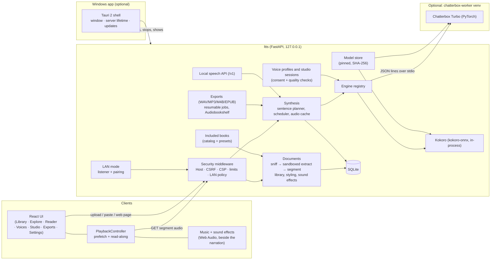

# Architecture

> **In short:** a React + TypeScript single-page app talks to one local FastAPI process over
> same-origin HTTP. The server extracts documents in a sandboxed subprocess, splits them into
> sentences, plans each sentence's voice and effect, synthesises it on demand with a pluggable engine,
> caches the audio by content hash, and streams it back. An optional voice-cloning engine runs in a
> separate, isolated Python environment and is driven over stdio. The server binds to `127.0.0.1`; the
> same web app and server are reached from a browser on the computer, from the Windows app (a Tauri
> window that bundles and runs the server), and from paired phones over LAN mode. Background music and
> sound effects play in the browser beside the narration, never mixed into it.

## Components

| Area           | Location                 | Notes                                                                                                                                                                                                                                                                         |
| -------------- | ------------------------ | ----------------------------------------------------------------------------------------------------------------------------------------------------------------------------------------------------------------------------------------------------------------------------- |
| Web UI         | `apps/web`               | Vite, React 19, Tailwind v4 tokens, Radix primitives, TanStack Query, React Router. Types generated from the server's OpenAPI schema (`npm run api:types`). Music, sound effects and the mixer are Web Audio graphs in `features/music`, `features/sfx` and `features/mixer`. |
| API server     | `apps/server/src/ltts`   | FastAPI app factory (`app.py`), manual DI container (`container.py`), feature packages: `documents`, `synthesis`, `engines`, `voices`, `exports`, `modelstore`, `library`, `sfx`, `lan`, `speech_api`, `pronunciation`.                                                       |
| Cloning worker | `apps/chatterbox-worker` | Separate uv project (Python 3.11, torch 2.11) installed on demand into `<data>/engines/chatterbox/venv`. `installed.json` records the lock's SHA-256; a changed lock is offered as an in-place update (ADR-8).                                                                |
| Windows app    | `apps/desktop`           | Tauri 2 shell (Rust), start-up screen, NSIS installer hooks and the runtime manifest; the bundled runtime (Python, server, built UI, Kokoro, uv) is assembled by `scripts/desktop/build-runtime.mjs`.                                                                         |
| Bootstrap      | `scripts/*.mjs`          | Node scripts: pinned uv download, `uv sync --frozen`, model install, process orchestration, repository and release checks.                                                                                                                                                    |
| Runtime data   | `data/` (git-ignored)    | `ltts.sqlite3`, `models/`, `engines/`, `cache/audio/`, `voices/`, `exports/`, `covers/`, `secrets/`, `tmp/`. The Windows app uses `%LOCALAPPDATA%\com.ttsnative.desktop\data` instead.                                                                                        |

## Key flows

**Reading a document.** The upload is streamed to `data/tmp` with a hard byte limit (no multipart
parser), its real type is sniffed from magic bytes, and a fresh spawned process extracts it with
time/memory limits. A web page is fetched by the server, which only connects to public addresses
and re-checks every redirect. Text is cleaned, split into sentences with stable boundaries, and stored
as segments grouped into sections (chapters, outline entries or pages). The included public-domain
books are EPUBs shipped in the server package and opened through the same pipeline (ADR-25).

**Listening.** The browser's `PlaybackController` requests the current sentence at playback priority
and the next three at prefetch priority. The server plans each sentence (its own voice, the dialogue
voice for quoted speech, or the reading voice, plus any effect and pronunciation rules; ADR-13), checks
the content-addressed cache (key = engine revision + voice + pace + boundary + exact spoken text, plus
the effect when set), and otherwise queues synthesis on that engine's single worker thread. Each clip
gets click-free fades and a natural pause for its boundary (sentence, paragraph, section). The browser
plays the clip from a direct same-origin URL (WebKit refuses media from Blob URLs). Because each
sentence is its own clip, the highlight is exactly synchronised without guessing word timings.

**Music and sound effects.** Both are optional Web Audio graphs that follow the narration player from
outside: they never route or delay the narration, and are off at the start of every narration. Music
plays bundled tracks (ADR-18). Sound effects are anchored to sentences; suggestions come from
deterministic word rules on the server, are stored as data and play only once accepted (ADR-22).
Neither is in exports yet.

**Custom voices.** The browser records (MediaRecorder) or decodes an imported file, converts it to
24 kHz mono WAV, and shows instant quality checks. The server repeats the checks authoritatively,
requires the consent flag, trims and normalises the clip, and stores only that WAV plus metadata.
Studio voices average the speaker over a guided session (ADR-9, ADR-11) and can be fine-tuned and
kept only after comparison (ADR-16); voices are shared as checked `.ttsvoice` packages without their
recordings (ADR-12). Deletion removes the recordings, the profile and all cached audio made with it.

**Export.** A background job renders every sentence in range at export priority (live playback stays
responsive), saving each sentence so a paused, failed or interrupted export resumes with only the
missing ones. It streams PCM into a libsndfile writer (WAV or MP3), or builds an M4B with the user's
ffmpeg or a read-along EPUB 3 with Media Overlays, optionally with SRT subtitles or one file per
chapter. A finished file can be sent to the user's own Audiobookshelf server.

**Phones and tablets.** LAN mode, turned on in Settings and off again after every restart, adds a
second listener on one home-network address, on a network Windows lists as private (or one the person
confirms elsewhere). Devices pair with a one-time code and then hold an address-bound cookie.
`lan/policy.py` lists what a paired device may reach; voices, engines, settings and anything that
throws work away stay on the computer, and a new route stays there until it is listed. See
[lan-access.md](../guides/lan-access.md) and the user's view in
[What Works Where](../wiki/What-Works-Where.md).

**The Windows app.** A Tauri 2 window loads the UI from the bundled server on
`http://127.0.0.1:<port>` (8770 first, up to 8789), so every server protection applies unchanged. The
shell starts the bundled Python with no console in a kill-on-close Job Object, removes inherited
`LTTS_*` variables, and stops the server through its stdin. Updates come only from GitHub Releases and
install only after their minisign signature matches the key built into the app (ADR-19, ADR-20). See
[desktop-and-releases.md](desktop-and-releases.md).

**Other programs.** The optional local speech API (`/v1/audio/speech`, OpenAI-compatible) is off by
default, needs a token, refuses web pages and, unless allowed, other devices
([local-speech-api.md](../guides/local-speech-api.md)).

## Design decisions

See [decisions.md](decisions.md) for the ADRs: the stack (ADR-1, ADR-2), per-sentence synthesis
(ADR-3), the isolated cloning engine and its updates (ADR-4, ADR-8), raw-body uploads (ADR-5), no LLM
in the pipeline (ADR-6), local-only by default (ADR-7), studio voices (ADR-9, ADR-11, ADR-16), voice
sharing (ADR-12), sentence planning (ADR-13), background music (ADR-18), the Windows app, updates and
change files (ADR-19 to ADR-21), sound effects (ADR-22), library organisation (ADR-24) and the
included books (ADR-25). Design notes:
[desktop-and-releases.md](desktop-and-releases.md), [background-music.md](background-music.md) and
[literary-library.md](literary-library.md).
