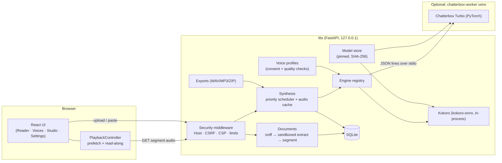

# Architecture

> **In short:** a React + TypeScript single-page app talks to one local FastAPI process over
> same-origin HTTP. The server extracts documents in a sandboxed subprocess, splits them into
> sentences, synthesises each sentence on demand with a pluggable engine, caches the audio by content
> hash, and streams it back. An optional voice-cloning engine runs in a separate, isolated Python
> environment and is driven over stdio. Everything binds to `127.0.0.1`.

## Components

| Area           | Location                 | Notes                                                                                                                                                                                                        |
| -------------- | ------------------------ | ------------------------------------------------------------------------------------------------------------------------------------------------------------------------------------------------------------ |
| Web UI         | `apps/web`               | Vite, React 19, Tailwind v4 tokens, Radix primitives, TanStack Query, React Router. Types generated from the server's OpenAPI schema (`npm run api:types`).                                                  |
| API server     | `apps/server/src/ltts`   | FastAPI app factory (`app.py`), manual DI container (`container.py`), feature packages: `documents`, `synthesis`, `engines`, `voices`, `exports`, `modelstore`.                                              |
| Cloning worker | `apps/chatterbox-worker` | Separate uv project (Python 3.11, torch 2.11) installed on demand into `data/engines/chatterbox/venv`. `installed.json` records the lock's SHA-256; a changed lock is offered as an in-place update (ADR-8). |
| Bootstrap      | `scripts/*.mjs`          | Node scripts: pinned uv download, `uv sync --frozen`, model install, process orchestration.                                                                                                                  |
| Runtime data   | `data/` (git-ignored)    | `ltts.sqlite3`, `models/`, `engines/`, `cache/audio/`, `voices/`, `exports/`, `tmp/`.                                                                                                                        |

## Key flows

**Reading a document.** The upload is streamed to `data/tmp` with a hard byte limit (no multipart
parser), its real type is sniffed from magic bytes, and a fresh spawned process extracts it with
time/memory limits. Text is cleaned, split into sentences with stable boundaries, and stored as
segments grouped into sections (chapters, outline entries or pages).

**Listening.** The browser's `PlaybackController` requests the current sentence at playback priority
and the next three at prefetch priority. The server checks the content-addressed cache (key = engine
revision + voice + pace + boundary + exact spoken text), otherwise queues synthesis on that engine's
single worker thread. Each clip gets click-free fades and a natural pause for its boundary (sentence,
paragraph, section). The browser then plays the clip from a direct same-origin URL (WebKit refuses
media from Blob URLs). Because each sentence is its own clip, the highlight is exactly synchronised
without guessing word timings. Skipping aborts requests that are no longer needed, and queued work
nobody is waiting for is cancelled.

**Custom voices.** The browser records (MediaRecorder) or decodes an imported file, converts it to
24 kHz mono WAV, and shows instant quality checks. The server repeats the checks authoritatively,
requires the consent flag, trims and normalises the clip, and stores only that WAV plus metadata.
Synthesis with a custom voice routes to the cloning engine with the reference path; deletion removes
the recording, the profile and all cached audio generated with it.

**Export.** A background job renders every sentence in range at export priority (live playback stays
responsive), streams PCM into a libsndfile writer (WAV or MP3) and optionally zips one file per
chapter with an M3U playlist. Cancelled or interrupted exports resume quickly because sentences are
cached.

## Design decisions

See [decisions.md](decisions.md) for the ADRs (stack choice, isolation of the cloning engine,
per-sentence synthesis, bootstrap strategy, raw-body uploads, no LLM in the pipeline).
